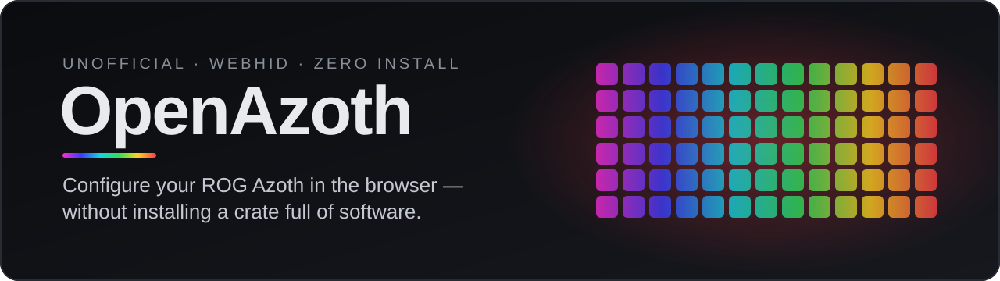
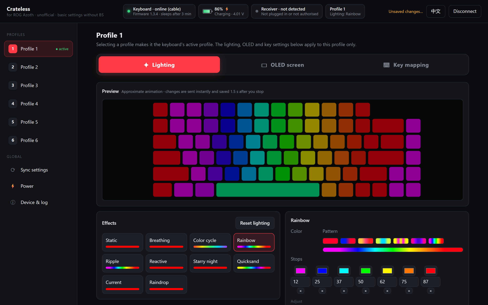
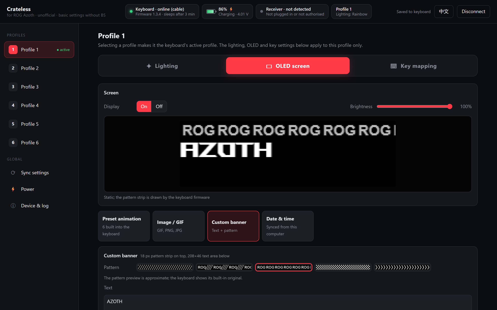
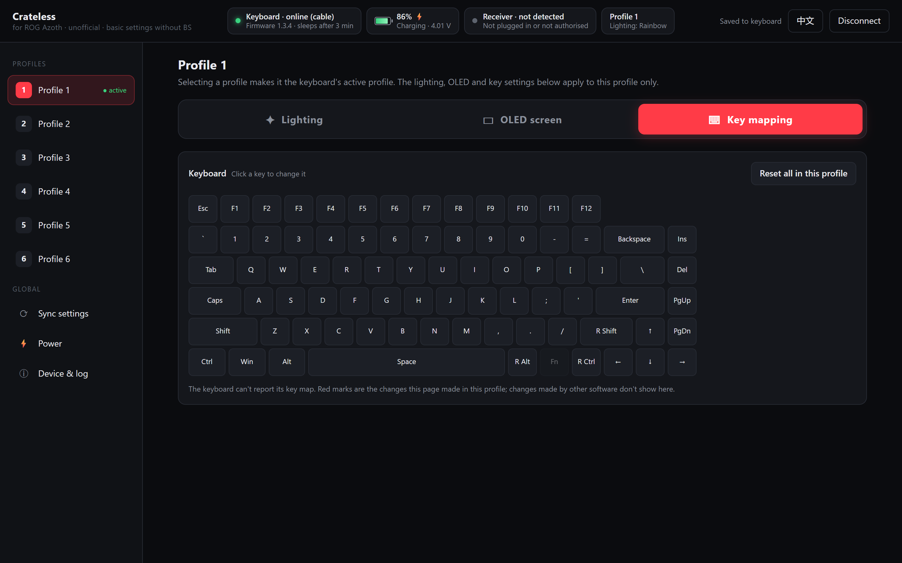
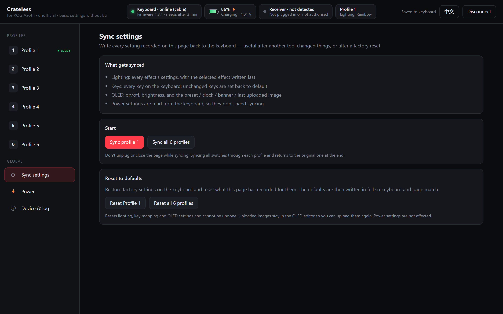
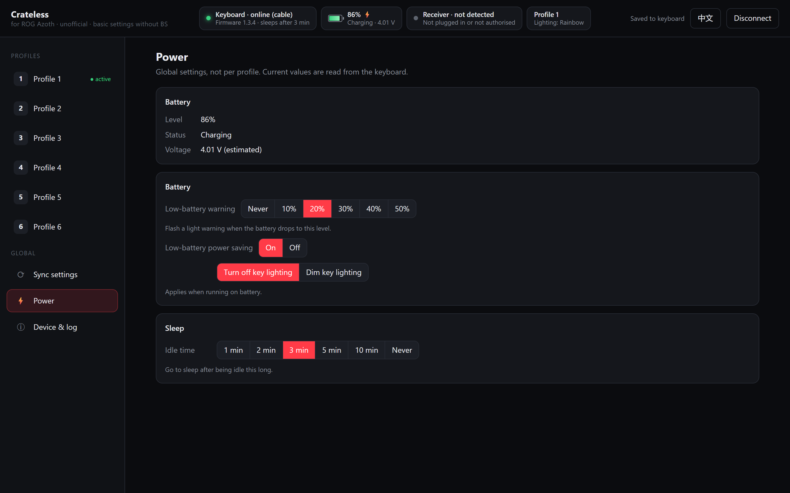
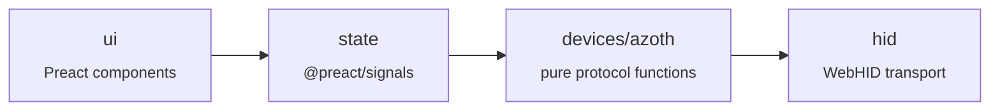

<div align="center">

<a href="https://albzo.github.io/OpenAzoth/"></a>

<p>
  <a href="https://albzo.github.io/OpenAzoth/"></a>
</p>

<p>
  <a href="https://github.com/albzO/OpenAzoth/actions/workflows/ci.yml"></a>
  <a href="https://github.com/albzO/OpenAzoth/actions/workflows/pages.yml"></a>
  <a href="LICENSE"></a>
  
  
</p>

**English** · [中文](README.zh-CN.md)

[Features](#features) · [Quick start](#quick-start) · [Why](#why) · [Development](#development)

</div>

<br>

<p align="center">
  
  <br>
  <sub><b>Lighting</b>: all 10 effects with the same options as the official page (colors, gradient, background, brightness, speed, width, direction), previewed live and applied instantly.</sub>
</p>

OpenAzoth is a **web page** for the ROG Azoth keyboard: open it, click *Connect keyboard*, and change lighting, the OLED screen, key mapping and power settings. Nothing to install, nothing running in the background.

> Formerly called **Crateless**. Settings saved in the browser carry over.

> [!IMPORTANT]
> **Unofficial. Not affiliated with or endorsed by ASUS.** "ROG" and "Azoth" are trademarks of their respective owners and are used only to say which device this works with.
>
> **Supported device:** the original ROG Azoth only (wired, its 2.4 GHz receiver, or an Omni receiver). Not the Azoth Extreme, Azoth X or Azoth 96 HE.

## Features

<table>
  <tr>
    <td width="50%" valign="top">
      
      <h3>OLED screen</h3>
      Built-in presets, upload a GIF/image (16 grey levels, up to 196 frames), custom banner, date &amp; time, on/off and brightness. Saved images go to a library you can switch back to in one click.
    </td>
    <td width="50%" valign="top">
      
      <h3>Key mapping</h3>
      Remap any key to another key, a media key or a mouse button. Written to the keyboard instantly.
    </td>
  </tr>
  <tr>
    <td width="50%" valign="top">
      
      <h3>Sync &amp; reset</h3>
      Write everything recorded here back to the keyboard (one profile or all six), or factory-reset lighting, key mapping, one profile or all profiles.
    </td>
    <td width="50%" valign="top">
      
      <h3>Power</h3>
      Low-battery warning, power saving and sleep timeout, with the current values read from the keyboard.
    </td>
  </tr>
</table>

**And also**

| | |
|---|---|
| ✎ **Canvas editor** | Layer images and GIFs on the 208×64 screen: move, scale, rotate, mirror, gamma, a timeline with trimming. Upload, save to the library or download as a GIF. Works without a keyboard |
| 📟 **Live status** | Firmware, battery / charging / voltage, receiver, active profile |
| 🌐 **Languages** | 中文 / English |

> [!NOTE]
> **Not supported:** system info, music visualizer, system notifications, software macros. They need a program running on the computer, which a web page can't provide.

## Quick start

1. Open **https://albzo.github.io/OpenAzoth/** in **desktop Chrome or Edge** (WebHID is required).
2. Click **Connect keyboard** and pick **ROG AZOTH** (cable) or **ROG OMNI RECEIVER** (wireless).
3. Change things. After the first time it connects automatically.

> [!TIP]
> The keyboard can't report key maps, lighting colors or OLED content, so the page keeps what you set in the browser, per keyboard (by serial number) and per profile. Use **Sync settings** to push it all back after a reset or on another computer.

## Why

For the Azoth, the official web configurator runs in "Legacy Mode": you have to install a desktop companion before you can change any setting.

| | Official companion | OpenAzoth |
|---|:---:|:---:|
| Install | Desktop app + driver | None, it's a web page |
| Background processes | **7** | **0** |
| Private memory | **~136 MB** | Only while the tab is open |
| Kernel filter driver | Yes | No |
| Tray app | Yes | No |

The settings live in the keyboard itself. A browser can send them over WebHID directly.

## Development

```bash
npm install
npm run dev        # http://127.0.0.1:5173
npm test           # protocol and image-processing unit tests
npm run build      # outputs dist/
```

Dependencies only point one way:



The protocol layer touches no browser APIs, so it is tested without a keyboard. To add a language, add a dictionary next to `src/i18n/en.ts`; the type checker lists any missing keys.

<details>
<summary><b>Project layout</b></summary>

```
src/
  hid/            WebHID transport (device-agnostic): send/ack/queue, chunked upload, discovery
  devices/azoth/  Azoth protocol as pure functions: info, lighting, keys, OLED, power
  media/          image processing: GIF decode/encode, 16-level grey, layer composition, banner text layout
  state/          app state (@preact/signals): connection & live status, per-profile settings, actions, sync
  i18n/           dictionaries (zh, en) and labels for protocol values
  ui/             Preact components
tests/            unit tests (expected bytes come from real keyboard traffic)
tools/            Python CLI, local artwork extraction script
docs/PROTOCOL.md  protocol notes
```

</details>

<details>
<summary><b>Vendor artwork</b></summary>

The banner patterns and preset-animation previews are ASUS artwork and are **not in this repository**. The deploy workflow downloads the still images (banner strips and one frame per preset) at build time; without them the page draws approximations (the screenshots above use the approximations). For the full animated previews locally, run:

```bash
python tools/fetch_rog_banners.py
```

Files go to `public/rog-assets/`, which is git-ignored. The keyboard always shows its own built-in originals.

</details>

Protocol notes: [docs/PROTOCOL.md](docs/PROTOCOL.md) · Changes: [CHANGELOG.md](CHANGELOG.md)

## License

[MIT](LICENSE)
