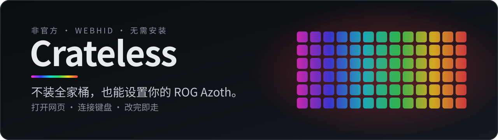
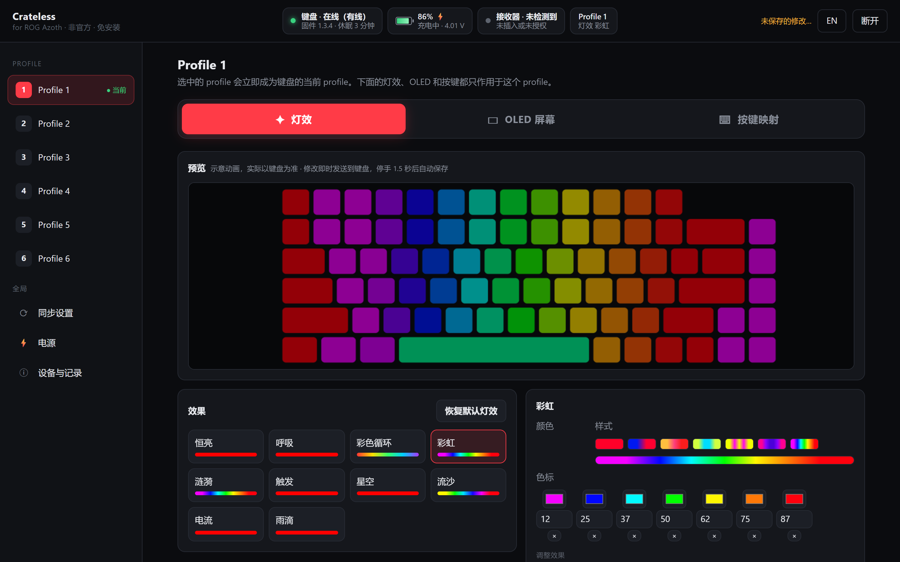
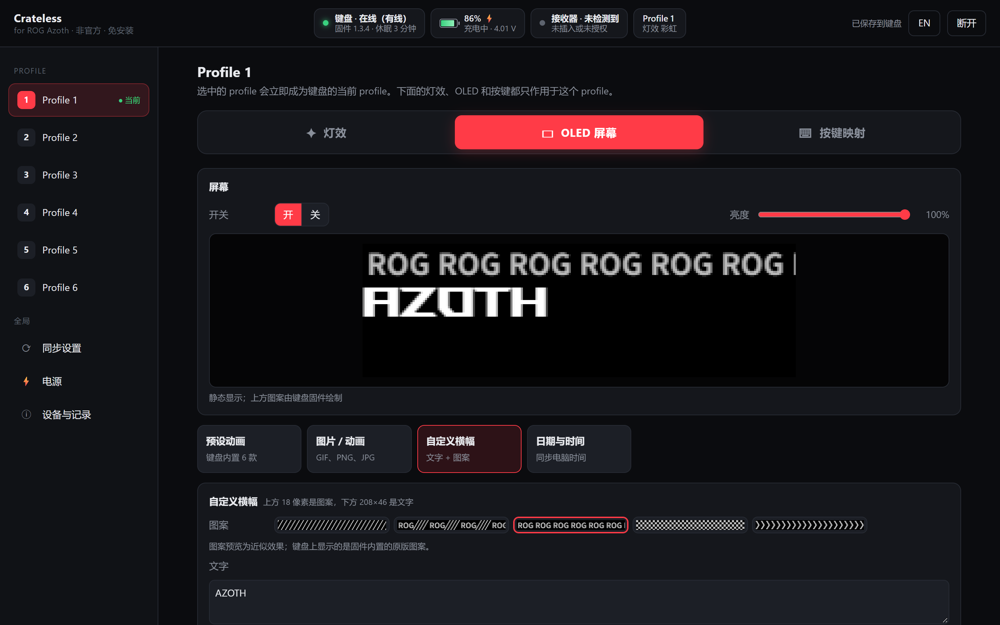
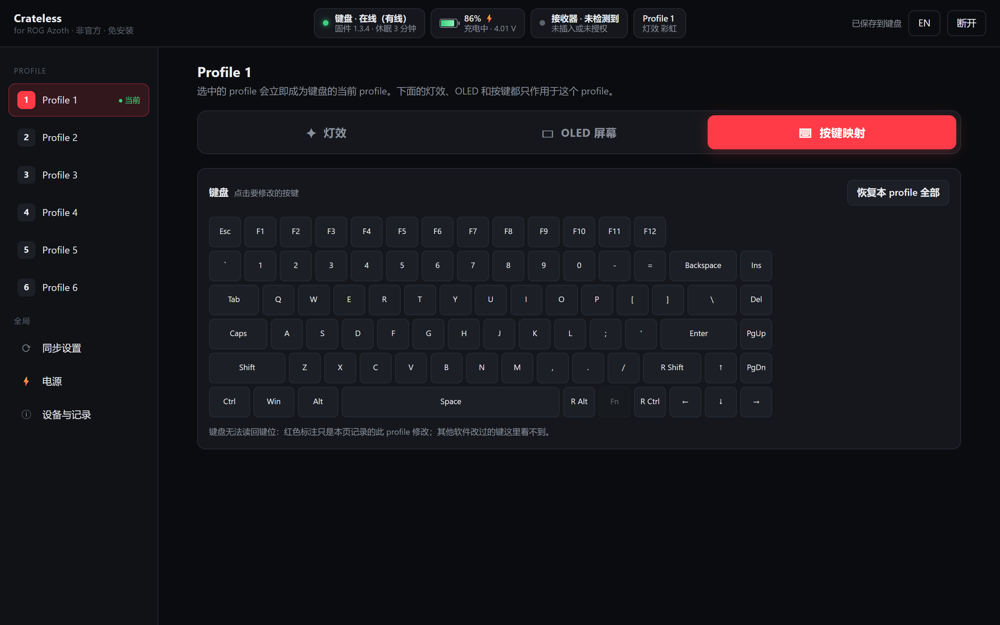
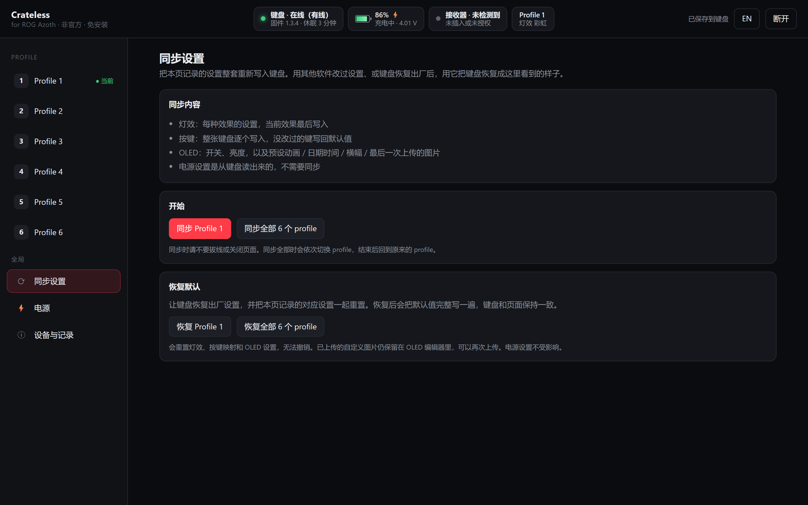
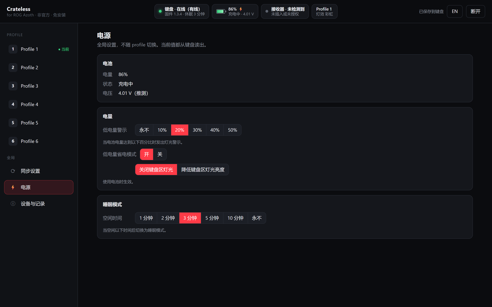
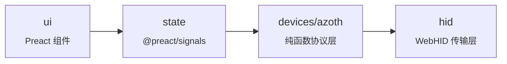

<div align="center">

<a href="https://albzo.github.io/OpenAzoth/"></a>

<p>
  <a href="https://albzo.github.io/OpenAzoth/"></a>
</p>

<p>
  <a href="https://github.com/albzO/OpenAzoth/actions/workflows/ci.yml"></a>
  <a href="https://github.com/albzO/OpenAzoth/actions/workflows/pages.yml"></a>
  <a href="LICENSE"></a>
  
  
</p>

[English](README.md) · **中文**

[功能](#功能) · [快速上手](#快速上手) · [为什么做这个](#为什么做这个) · [开发](#开发)

</div>

<br>

<p align="center">
  
  <br>
  <sub><b>灯效</b>：全部 10 种效果，选项与官方网页一致（颜色、渐变、背景色、亮度、速度、宽度、方向），实时预览，改动即时生效。</sub>
</p>

OpenAzoth 是一个**纯网页**的 ROG Azoth 设置工具：打开网页、点“连接键盘”，就能改灯效、OLED 屏幕、按键映射和电源设置。不需要安装任何程序，也没有后台常驻服务。

> 原名 **Crateless**，浏览器里保存的设置不受影响。

> [!IMPORTANT]
> **非官方项目，与 ASUS 无关，也未获其认可。** “ROG”“Azoth”是其各自所有者的商标，这里只用来说明适用的设备。
>
> **支持的设备：** 仅限初代 ROG Azoth（有线、原装 2.4G 接收器或 Omni 接收器）。不支持 Azoth Extreme、Azoth X、Azoth 96 HE。

## 功能

<table>
  <tr>
    <td width="50%" valign="top">
      
      <h3>OLED 屏幕</h3>
      内置预设动画、上传 GIF/图片（16 级灰度，最多 196 帧）、自定义横幅、日期时间、开关和亮度。图片可存进图片库，之后一键换回。
    </td>
    <td width="50%" valign="top">
      
      <h3>按键映射</h3>
      把任意键映射成其他键、媒体键或鼠标按键，即时写入键盘。
    </td>
  </tr>
  <tr>
    <td width="50%" valign="top">
      
      <h3>同步与恢复默认</h3>
      把本页记录的设置重新写回键盘（单个 profile 或全部 6 个），或恢复灯效、按键映射、单个 profile 或全部 profile 的出厂设置。
    </td>
    <td width="50%" valign="top">
      
      <h3>电源</h3>
      低电量警示、省电模式、休眠时间，当前值直接从键盘读取。
    </td>
  </tr>
</table>

**另外还有**

| | |
|---|---|
| ✎ **画布编辑器** | 在 208×64 屏幕上叠放多张图片和 GIF：拖动、缩放、旋转、镜像、调 gamma，带可裁剪的时间轴。可上传、存进图片库或下载成 GIF，不接键盘也能用 |
| 📟 **实时状态** | 固件、电量/充电/电压、接收器、当前 profile |
| 🌐 **语言** | 中文 / English |

> [!NOTE]
> **不支持：** 系统信息、音乐频谱、系统通知、软件宏。这些需要电脑端程序持续提供数据，网页做不到。

## 快速上手

1. 用**桌面版 Chrome 或 Edge** 打开 **https://albzo.github.io/OpenAzoth/**（需要 WebHID）。
2. 点 **连接键盘**，选择 **ROG AZOTH**（有线）或 **ROG OMNI RECEIVER**（无线）。
3. 开始设置。之后再打开会自动连接。

> [!TIP]
> 键盘无法读回按键映射、灯效颜色和 OLED 内容，所以页面会把你的设置存在浏览器里，按键盘（序列号）和 profile 分开记录。恢复出厂或换电脑后，用 **同步设置** 一键写回。

## 为什么做这个

官方网页设置工具对 Azoth 走“Legacy Mode”，必须先安装电脑端的 Companion 才能改设置。

| | 官方 Companion | OpenAzoth |
|---|:---:|:---:|
| 安装 | 桌面程序 + 驱动 | 无，就是一个网页 |
| 后台进程 | **7 个** | **0 个** |
| 私有内存 | **约 136 MB** | 只在标签页打开时占用 |
| 内核过滤驱动 | 有 | 无 |
| 托盘程序 | 有 | 无 |

这些设置本来就存在键盘里，浏览器通过 WebHID 直接发给键盘就够了。

## 开发

```bash
npm install
npm run dev        # http://127.0.0.1:5173
npm test           # 协议和图像处理的单元测试
npm run build      # 输出到 dist/
```

依赖只朝一个方向：



协议层不碰任何浏览器 API，所以不接键盘也能测试。要加一种语言，在 `src/i18n/en.ts` 旁边加一份词典即可，类型检查会列出缺少的词条。

<details>
<summary><b>目录结构</b></summary>

```
src/
  hid/            WebHID 传输层（与设备无关）：收发/应答/队列、分包上传、设备发现
  devices/azoth/  Azoth 协议，全部是纯函数：设备信息、灯效、按键、OLED、电源
  media/          图像处理：GIF 解码/编码、16 级灰度、图层合成、横幅文字排版
  state/          应用状态（@preact/signals）：连接与实时状态、各 profile 设置、操作、同步
  i18n/           中英文词典，以及协议值的显示名称
  ui/             Preact 组件
tests/            单元测试（期望的字节来自真实键盘通信）
tools/            Python 命令行工具、本地素材下载脚本
docs/PROTOCOL.md  协议笔记
```

</details>

<details>
<summary><b>厂商素材</b></summary>

横幅图案和预设动画预览是 ASUS 的素材，**不在这个仓库里**。部署流程会在构建时下载静态图（横幅图案和每个预设的一帧画面）；没有这些文件时，页面会画近似图案（上面的截图用的就是近似图案）。想在本地看完整的动画预览，运行：

```bash
python tools/fetch_rog_banners.py
```

文件会放到 `public/rog-assets/`，这个目录已被 git 忽略。键盘本身始终显示固件里的原版。

</details>

协议笔记：[docs/PROTOCOL.md](docs/PROTOCOL.md) · 更新日志：[CHANGELOG.md](CHANGELOG.md)

## 许可证

[MIT](LICENSE)
